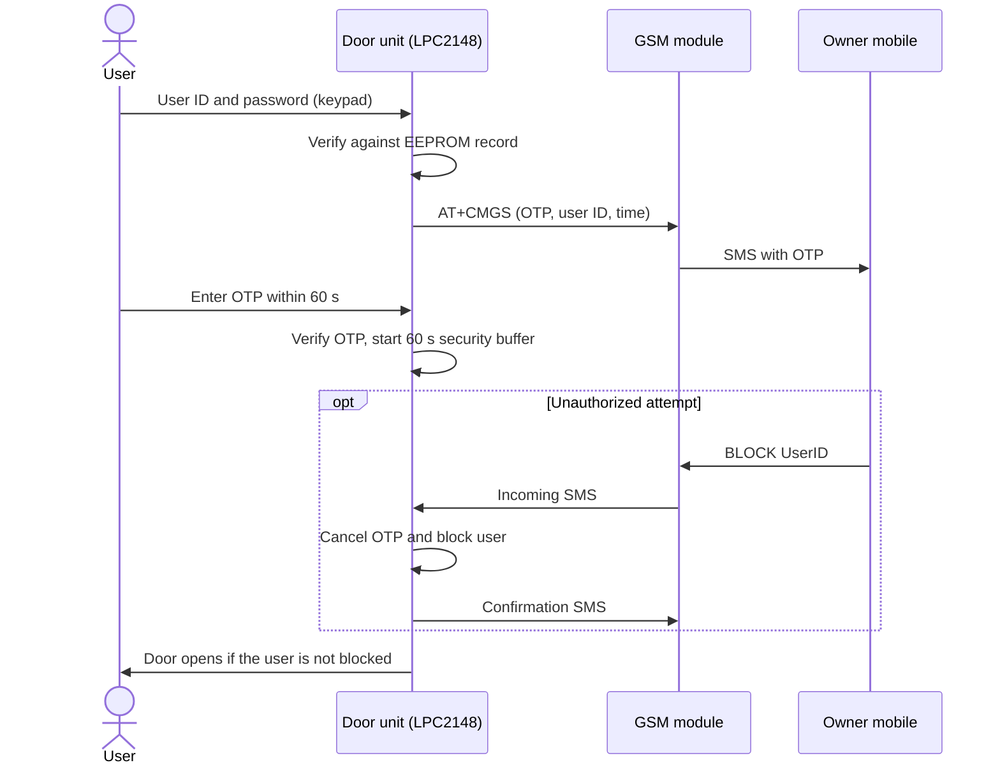

# SecureEntry-OTP-GSM-Door-Access-System
GSM-based two-step door access system on LPC2148. Keypad user ID and password login, time-limited SMS OTP, remote BLOCK/UNBLOCK by SMS, SPI EEPROM user storage, RTC timestamps, and user-detail updates via external interrupt. Embedded C, Keil.

<div align="center">

# SecureEntry OTP

### GSM-Based Two-Step, Time-Limited Door Access System

*Keypad login + SMS one-time password + remote block/unblock, built on the LPC2148 (ARM7).*


</div>

---

## Table of Contents

1. [Overview](#overview)
2. [Key Features](#key-features)
3. [System Architecture](#system-architecture)
4. [Hardware](#hardware)
5. [Working Principle](#working-principle)
6. [User Management](#user-management)
7. [SMS Commands and Message Format](#sms-commands-and-message-format)
8. [Security Parameters](#security-parameters)
9. [EEPROM Memory Map](#eeprom-memory-map)
10. [Project Structure](#project-structure)
11. [Build and Flash](#build-and-flash)
12. [Limitations and Future Work](#limitations-and-future-work)
13. [Author](#author)
14. [License](#license)

---

## Overview

**SecureEntry OTP** is an embedded door access system that adds a second authentication factor to a conventional keypad lock. A user enters a unique **user ID** and **password** on a 4x4 keypad. If both match the record stored in the external EEPROM, the system generates a **time-limited OTP** and sends it by **SMS** to the mobile number registered for that user. The door opens only after the correct OTP is entered within the allowed time.

The registered owner stays in control remotely: if the SMS arrives and the owner did not request it, replying **`BLOCK <UserID>`** cancels the pending OTP and blocks that user ID. Replying **`UNBLOCK <UserID>`** restores access, after which the full authentication process must be completed again.

---

## Key Features

- **Two-step authentication**: user ID and password, followed by an SMS OTP.
- **Time-limited 6-digit OTP** (60 s validity) with resend option and a limit of 3 wrong attempts.
- **Remote BLOCK / UNBLOCK by SMS**, accepted only from the user's registered mobile number.
- **Security buffer**: a 60 s window after OTP verification in which the owner can still block the attempt before the door opens.
- **Password lockout**: 3 wrong passwords lock the user for 120 s.
- **Persistent storage** of users, passwords, mobile numbers and block state in an external SPI EEPROM (AT25LC512).
- **Admin-controlled user management** (add, delete, block/unblock, modify, change admin password) opened through an external interrupt switch.
- **Non-blocking SMS handling**: incoming SMS is checked in the background by an interrupt-driven UART driver.
- **RTC timestamp** on every OTP alert, so the owner sees when access was requested.
- **Motor-driven door** through an L293D, with custom door open/close icons on the LCD.

---

## System Architecture

### Hardware block diagram


### Firmware architecture

The firmware is organised in layers so that each module depends only on the layer below it.


| Layer | Modules | Responsibility |
|-------|---------|----------------|
| Application | `main.c`, `Login()`, `UserManagement()`, `SecurityBuffer()` | Top-level flow and state handling |
| Service | `otp.c`, `user.c`, `door.c`, `door_cgram.c` | OTP generation and expiry, user records and lockout, door motor and LCD icons |
| Driver | `gsm.c`, `Keypad.c`, `lcd.c`, `rtc.c`, `spi_eeprom.c`, `eint.c`, `switch.c` | Device-level drivers |
| Peripheral / HAL | `uart.c`, `spi.c`, `delay.h`, `types.h`, `defines.h` | Register-level access to LPC2148 peripherals |

---

## Hardware

| Component | Purpose | Connection |
|-----------|---------|------------|
| LPC2148 (ARM7TDMI-S) | Main controller, 12 MHz crystal, CCLK 60 MHz, PCLK 15 MHz | - |
| SIMCOM A7662 GSM module | Sends the OTP SMS and receives BLOCK / UNBLOCK commands | UART0: P0.0 (TXD0), P0.1 (RXD0), 9600 baud |
| 16x2 LCD | User prompts and status messages | Data P0.8 - P0.15, control lines on P0.16 - P0.18 |
| 4x4 matrix keypad | ID, password and OTP entry | Rows P1.16 - P1.19, columns P1.20 - P1.23 |
| Push switch | Opens user-management mode | P0.3 (EINT1) |
| AT25LC512 SPI EEPROM | Non-volatile user data | SPI0: SCK P0.4, MISO P0.5, MOSI P0.6, CS P0.7 |
| L293D + DC motor | Door actuator | P0.20 (IN1), P0.21 (IN2) |

> **Important:** power the AT25LC512 from **3.3 V**.

**Keypad keys:** `0-9` digits, `B` backspace, `C` clear, `D` enter, `*` previous, `#` next.

---

## Working Principle

### Authentication flow


### Message sequence



### Step by step

1. **Startup**: the LCD, keypad, EINT1, UART0, GSM module, RTC, SPI, user records and door driver are initialised. The GSM network status is checked, and the system continues even if the network is not ready yet.
2. **User ID**: the user enters the ID. The system confirms that it exists and that the user is not blocked.
3. **Password**: the entered password is compared with the EEPROM record (30 s input timeout, 3 attempts, then a 120 s lockout).
4. **OTP**: a 6-digit OTP is generated and sent, with the user ID and a timestamp, to the registered mobile number.
5. **OTP entry**: the user has 60 s to enter it. On expiry the user can request a new OTP or go back. Three wrong OTPs deny access.
6. **Security buffer**: for 60 s the system listens for `BLOCK <UserID>` from the registered number.
7. **Door**: if no block arrives, the motor opens the door (2 s), holds it open (10 s) and closes it (2 s).

---

## User Management

Pressing the switch on **EINT1 (P0.3)** raises an interrupt flag. The main loop then enters user-management mode after admin authentication.


Each user ID stays fixed once created. Passwords and registered mobile numbers can be updated, and the new values are written to the EEPROM slot assigned to that user. Up to **4 users** are supported.

---

## SMS Commands and Message Format

| Direction | Message | Result |
|-----------|---------|--------|
| System to user | `SecureEntry: OTP:<6 digits> FOR USER ID:<ID> TIME:<dd-mm-yyyy hh:mm> VALID:60SEC. IF NOT YOU, REPLY BLOCK <ID> / UNBLOCK <ID>. Please Do Not Share OTP with Anyone` | OTP and access alert |
| User to system | `BLOCK <UserID>` | Cancels any pending OTP and blocks the user |
| User to system | `UNBLOCK <UserID>` | Restores access; full authentication is required again |

Commands are accepted only from the **mobile number registered for that user ID**.

**GSM initialisation sequence** (each response is checked, and the LCD shows an error on failure):

```
AT
ATE0
AT+CMGF=1
AT+CNMI=2,1,0,0,0
AT+CMGD=1
AT+CMGR=1
AT+CMGS="<mobile number>"
```

---

## Security Parameters

| Parameter | Value |
|-----------|-------|
| Maximum users | 4 |
| User ID / password length | 4 characters |
| Mobile number length | 10 digits |
| Password input timeout | 30 s |
| Wrong password attempts | 3, then 120 s lockout |
| OTP length | 6 digits (100000 - 999999) |
| OTP validity | 60 s |
| Wrong OTP attempts | 3 |
| Security buffer | 60 s |
| Door motor open / hold / close | 2 s / 10 s / 2 s |

---

## EEPROM Memory Map


Initialisation markers make sure default data is written only once, so users and the admin password survive power cycles.

---

## Project Structure

```
SecureEntry-OTP-LPC2148/
├── src/
│   ├── main.c              # Initialisation and main loop
│   ├── user.c / user.h     # Login, users, lockout, admin menu, security buffer
│   ├── otp.c / otp.h       # OTP generation, verification, expiry
│   ├── gsm.c / gsm.h       # AT-command driver, SMS send / receive
│   ├── uart.c / uart.h     # Interrupt-driven UART0
│   ├── uart_defines.h
│   ├── Keypad.c / kpm.h    # 4x4 keypad driver
│   ├── kpm_defines.h
│   ├── lcd.c / lcd.h       # 16x2 LCD driver
│   ├── lcd_defines.h
│   ├── rtc.c / rtc.h       # On-chip RTC
│   ├── spi.c / spi.h       # SPI0 driver
│   ├── spi_defines.h
│   ├── spi_eeprom.c / .h   # AT25LC512 byte read / write
│   ├── spi_eeprom_defines.h
│   ├── eint.c / eint.h     # EINT1 interrupt (user management)
│   ├── switch.c / switch.h
│   ├── door.c / door.h     # L293D motor control
│   ├── door_cgram.c / .h   # Custom LCD door icons
│   ├── main_dly.c / delay.h# Delay routines
│   └── types.h / defines.h
├── docs/
│   └── images/             # Diagrams used in this README
└── README.md
```

---

## Build and Flash

**Tools:** Keil uVision (ARM7 / LPC2148 target) and Flash Magic.

1. Create a Keil project for **NXP LPC2148** and add every `.c` file from `src/`.
2. Set the crystal to 12 MHz and enable HEX file generation.
3. Build the project.
4. Flash the generated `.hex` file with **Flash Magic** over UART (select LPC2148 and the correct COM port).
5. Insert an active SIM into the A7662 module, connect all peripherals as in the [Hardware](#hardware) table, and power the EEPROM from 3.3 V.
6. On first boot the firmware writes default records to the EEPROM. Add or edit real users through the admin menu, then set your own admin password.

---

## Limitations and Future Work

- The OTP is derived from the RTC date and time with a fixed formula. This is fine for a demonstration, but a hardware random source or a keyed algorithm such as HMAC-based OTP would be stronger.
- Passwords are stored as plain values in the EEPROM. Hashing them would improve security.
- The RTC is set in firmware at start-up. A backup battery on the RTC supply and a one-time time-setting routine would keep time across power loss.
- Possible extensions: door-position sensing, a buzzer or tamper alarm, an event log in EEPROM, and SMS alerts to an admin number.

---

## Author

**Mavuri Ravi Kumar**  
Electronics and Communication Engineering

Developed as a guided embedded-systems project (LPC2148, GSM, SPI EEPROM, Embedded C).

---

## License

This project is released under the [MIT License](LICENSE).
